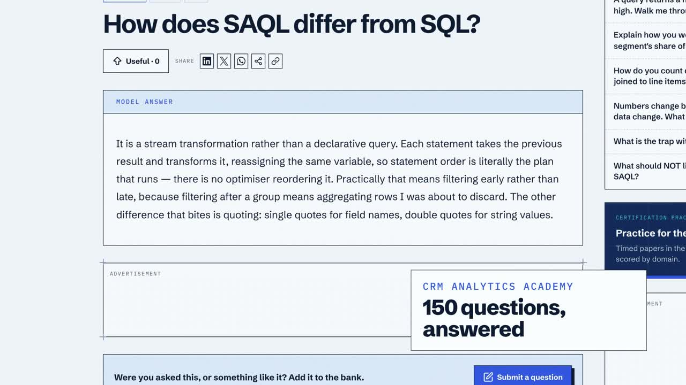
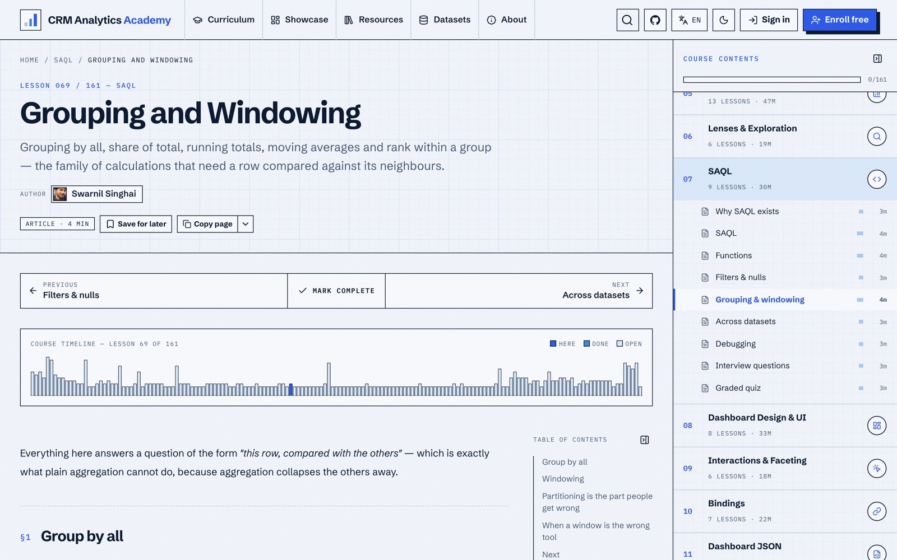
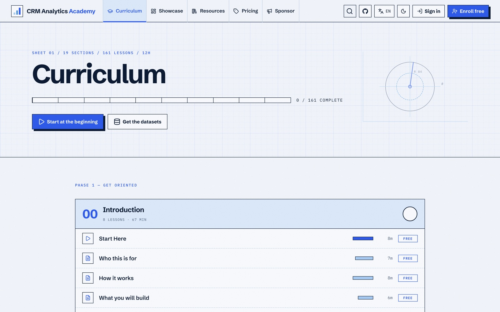
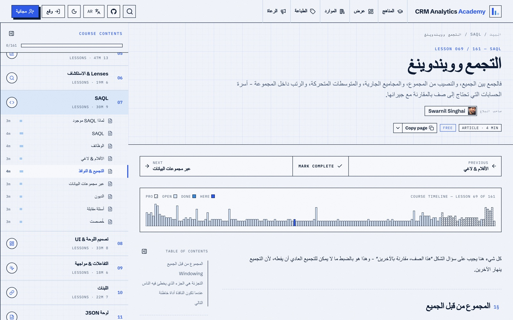
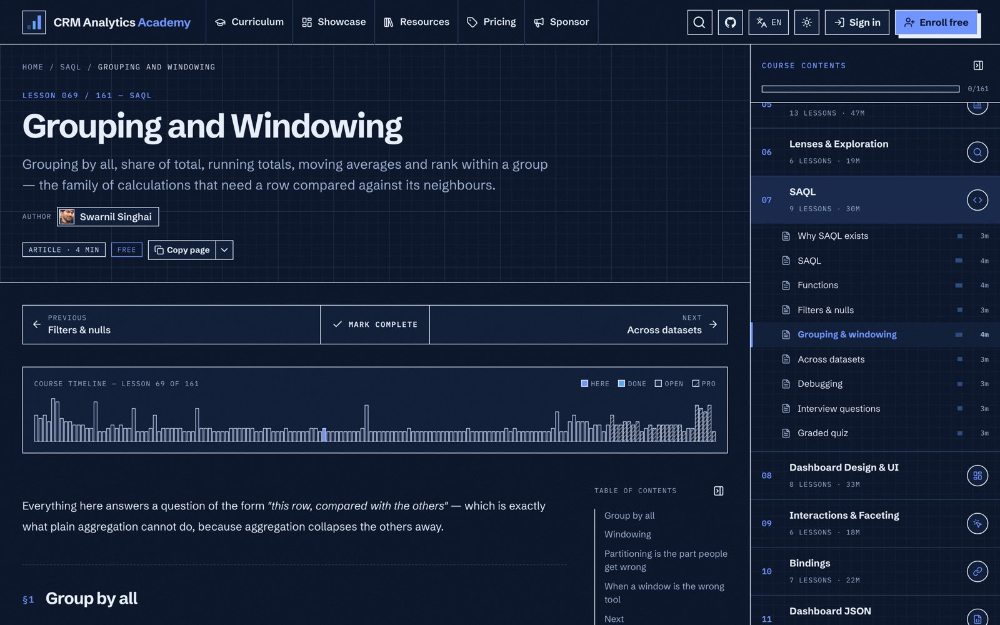
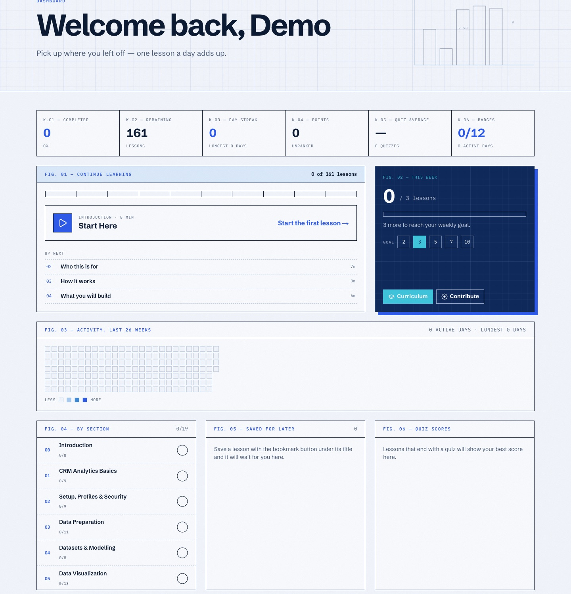
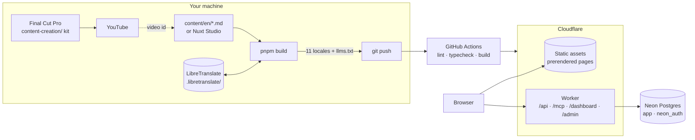

<p align="center"></p>

<h1 align="center">CRM Analytics Academy</h1>

<p align="center">
  <strong>Learn Salesforce CRM Analytics the way go-to-market teams actually use it.</strong><br>
  Data prep, SAQL, dashboards, bindings, Einstein Discovery, and funnel, pipeline and RevOps dashboards
  built end to end, in twelve languages. Most lessons are free and open source; a few hands-on ones are Pro.
</p>

<p align="center">
  <a href="https://crmanalytics.imswarnil.com"><strong>Live site</strong></a> ·
  <a href="https://crmanalytics.imswarnil.com/curriculum"><strong>Curriculum</strong></a> ·
  <a href="https://crmanalytics.imswarnil.com/introduction"><strong>Start lesson 1</strong></a> ·
  <a href="https://crmanalytics.imswarnil.com/llms.txt"><strong>llms.txt</strong></a> ·
  <a href="https://crmanalytics.imswarnil.com/contribute"><strong>Contribute</strong></a>
</p>

<p align="center">
  <a href="https://github.com/imswarnil/CRM-Analytics-Academy/stargazers"></a>
  <a href="https://github.com/imswarnil/CRM-Analytics-Academy/actions/workflows/deploy-cloudflare.yml"></a>
  <a href="https://www.youtube.com/@crmanalyticsacademy"></a>
  
  
  
  
  
  <a href="./LICENSE"></a>
</p>

<p align="center">
  <a href="./.github/demo/crma-academy-demo.mp4"></a><br>
  <sub>▶ <a href="./.github/demo/crma-academy-demo.mp4"><strong>Watch the 30-second tour</strong></a> — one real interview question, followed through the site. Made with HyperFrames from the live site's own screens (<code>demo-video/</code>).</sub>
</p>

---

## Why this exists

Salesforce CRM Analytics (formerly Wave, Einstein Analytics and Tableau CRM) is documented well in pieces
and poorly as a path. Most of what is written about it stops at "here is a chart". Very little shows how a
**go-to-market team** uses it: the funnel a marketing lead opens on Monday, the pipeline view a sales
manager reads before the forecast call, the NRR waterfall RevOps takes to the board.

The Academy is that path: **19 sections**, from "what is a dataset" through security
predicates, SAQL windowing, bindings and the dashboard JSON underneath, to a set of revenue dashboards built
on one company's data. **Everything is free** — no paywall, funded by ads. A free account adds a
dashboard that keeps you going: progress, a daily streak, a weekly goal, saved lessons, quiz scores, badges
and a leaderboard.

> **Published section by section.** The Introduction is live; the other 18 sections are being written and
> recorded, and each one's page already lists its planned lessons. Videos land on
> [YouTube @crmanalyticsacademy](https://www.youtube.com/@crmanalyticsacademy) as each section ships.

| You are… | Start here |
| --- | --- |
| New to CRM Analytics | [Introduction](https://crmanalytics.imswarnil.com/introduction) → [Basics](https://crmanalytics.imswarnil.com/foundations) |
| A Salesforce admin or developer adding analytics | [Data Preparation](https://crmanalytics.imswarnil.com/data-preparation) → [SAQL](https://crmanalytics.imswarnil.com/saql) → [Bindings](https://crmanalytics.imswarnil.com/bindings) |
| In RevOps, Sales Ops or Marketing Ops | [GTM Engineering](https://crmanalytics.imswarnil.com/gtm-engineering) → [Demand](https://crmanalytics.imswarnil.com/demand-analytics) → [Pipeline](https://crmanalytics.imswarnil.com/pipeline-analytics) → [RevOps & Retention](https://crmanalytics.imswarnil.com/revops-analytics) |
| An AI assistant | [`/llms.txt`](https://crmanalytics.imswarnil.com/llms.txt) (the course in order) · [`/llms-full.txt`](https://crmanalytics.imswarnil.com/llms-full.txt) (every lesson) · MCP at `/mcp` |
| Preparing for an interview | Every section ends with interview questions and a graded quiz |

## A look inside

| | |
| --- | --- |
|  |  |
| **Lesson player.** Course contents with progress, prev / mark complete / next, the course timeline, save for later. | **Curriculum.** Every section, plotted by length and kind; sections still being written are marked "soon". |
|  |  |
| **Twelve languages.** Written once in English and machine-translated locally; Arabic and Urdu render right to left. | **Dark mode.** The same drawing, inked in reverse. |


<p align="center"><br><sub><strong>Your dashboard.</strong> Continue, up next, streak, weekly goal, activity heatmap, saved lessons, quizzes, badges.</sub></p>

## Features

**Learning**
- **19 sections in 12 languages** — the Introduction is live; every other section has a "coming soon" page listing its planned lessons, so the outline is public, indexable and in `llms.txt` from day one.
- **Lesson player** — course-contents sidebar (collapsible to a progress-donut rail), prev / mark complete / next,
  a course timeline, table of contents, screen walkthroughs, graded quizzes, interview Q&A, comments.
- **Lesson videos** made in Final Cut Pro with the Academy's own template kit (`content-creation/`) and played from YouTube.
- **Datasets** (the Academy's own fictional business as CSVs) and curated **resources** with community
  submissions.

**Your dashboard** (free account)
- Continue card and an "up next" queue, progress by section.
- Daily **streak** and longest streak, a **weekly goal** you set, a 26-week **activity heatmap**.
- **Saved lessons**, **quiz scores** with retake prompts, **12 badges**, a top-5 **leaderboard**.

**Pro and products** (no payment processor)
- Lessons marked `access: pro` are members-only: the build ships a teaser, the Worker serves the rest to Pro
  members, and the build fails if any members-only passage is public (`scripts/verify-gating.mjs`).
- `/pro` sells Pro, a certification bootcamp, interview prep, mentoring, dashboard reviews, team training and
  consulting. "Get it" files a lead — saved in Neon and sent to **Salesforce as a Lead by Web-to-Lead** (no
  credentials, no API user). Access is granted by hand in `/admin`.
- Coming-soon sections have a **Notify me** waitlist (free account), with the count of who is waiting.

**Admin console** (`/admin`, one account only)
- **Overview** — visitors, views, users, sign-ups, Pro members, leads, waitlists, completions, submissions.
- **Leads** — every product request, its Salesforce status, and a new → contacted → won/lost pipeline.
- **Conversion** — a per-visitor funnel (visit → engaged → sign-up click → sign-up → learning) and sign-up
  rate by source and landing page.
- **Analytics** — first-party traffic: visitors, sessions, time on page, bounce, countries, devices, browsers,
  OS, referrers, languages, top pages, **sign-in / sign-up clicks** by page, live feed.
- **Users**, **Submissions** (approve / reject) and **Comments** (hide / restore).
- Content is edited in **Nuxt Studio** (`/_studio`), which commits markdown to GitHub.

**Advertising** (Google AdSense — readers who are signed in see none)
- Every placement is a `<PromoSlot>` in a Blueprint frame (label, size spec, crop marks), its space reserved
  so nothing jumps, and a fresh unit is requested on every page view.
- In-article units inside lessons, a sticky skyscraper under the table of contents, a unit in the course
  sidebar, a multiplex block after each lesson, a leaderboard on content pages, and a closable floating
  leaderboard. Inventory and slot ids: `app/utils/promo.ts`. `public/ads.txt` is published.
- A timed "subscribe on YouTube" card once per first session (AdSense units are never placed in pop-ups;
  Vignette ads come from AdSense Auto ads).

**Security**
- The site's own **proof-of-work captcha** (no third party) on sign-in, sign-up and lead forms, a honeypot, and
  per-address rate limits stored as hashes.
- Security headers on every response (HSTS, nosniff, frame and base-uri limits), a CSRF origin check on the API,
  escaped JSON-LD, sanitised community content, and an admin pinned to one account.

**Platform**
- **AI-ready** — `llms.txt` lists the course in learning order, `llms-full.txt` holds every lesson, any lesson is
  raw markdown at `/raw/<path>.md`, and a read-only **MCP server** at `/mcp`.
- **Privacy-friendly analytics** — no cookies, no IP addresses, no third-party trackers.
- **SEO** — JSON-LD per page type, hreflang across 12 languages, sitemap, OG images, IndexNow after deploys.
- **PWA** — installable, with an offline page.

## How it works



**Static-first.** Every public page is prerendered and served by Cloudflare straight from the edge. The Worker
runs only for what has no static file: the API, auth, MCP and the signed-in pages. Reading a lesson never
touches the database.

**Translation runs locally.** English is the only language anyone writes. `pnpm build` starts a LibreTranslate
server installed inside the repo (`.libretranslate/`), translates only what changed (a hash manifest tracks the
English source of every file), stops it, and the result is committed. CI never translates.

| Layer | Technology |
| --- | --- |
| Framework | [Nuxt 4](https://nuxt.com) (Vue 3, Vite, Nitro), TypeScript |
| Content | [Nuxt Content 3](https://content.nuxt.com) (markdown + MDC components), edited in [Nuxt Studio](https://nuxt.studio) |
| UI | [Nuxt UI v4](https://ui.nuxt.com), [Tailwind CSS 4](https://tailwindcss.com), the in-house **Blueprint** design system, Schibsted Grotesk + IBM Plex Mono |
| Hosting | [Cloudflare Workers](https://workers.cloudflare.com) (static assets + one Worker), R2 for submission images |
| Database | [Neon](https://neon.com) serverless Postgres — `server/db/schema.sql` |
| Auth | Neon Auth ([Better Auth](https://better-auth.com)), resolved server-side per request; a shared demo account |
| Analytics | First-party: `app.page_view` + `app.event`, read in `/admin → Analytics` |
| Translation | [LibreTranslate](https://libretranslate.com), installed locally, run by `pnpm build` |
| Video | [Final Cut Pro](https://www.apple.com/final-cut-pro/) with the CRMA template kit (`content-creation/`), published on YouTube |
| i18n | `@nuxtjs/i18n` — 12 locales, 2 RTL |
| SEO | `@nuxtjs/sitemap`, `nuxt-og-image`, JSON-LD, hreflang, IndexNow |
| Quality | ESLint, `vue-tsc`, GitHub Actions |
| Built with | [Claude Code](https://claude.com/claude-code) — directed and reviewed by a human |

## The curriculum

| # | Section | Lessons |
|---|---|---|
| 00 | [Introduction](https://crmanalytics.imswarnil.com/introduction) | 8 |
| 01 | [CRM Analytics Basics](https://crmanalytics.imswarnil.com/foundations) | 9 |
| 02 | [Setup, Profiles & Security](https://crmanalytics.imswarnil.com/setup) | 9 |
| 03 | [Data Preparation](https://crmanalytics.imswarnil.com/data-preparation) | 11 |
| 04 | [Datasets & Modelling](https://crmanalytics.imswarnil.com/datasets-and-modelling) | 8 |
| 05 | [Data Visualization](https://crmanalytics.imswarnil.com/data-visualization) | 13 |
| 06 | [Lenses & Exploration](https://crmanalytics.imswarnil.com/lenses-and-explorations) | 6 |
| 07 | [SAQL](https://crmanalytics.imswarnil.com/saql) | 9 |
| 08 | [Dashboard Design & UI](https://crmanalytics.imswarnil.com/designing-dashboards) | 8 |
| 09 | [Interactions & Faceting](https://crmanalytics.imswarnil.com/interactions) | 6 |
| 10 | [Bindings](https://crmanalytics.imswarnil.com/bindings) | 7 |
| 11 | [Dashboard JSON](https://crmanalytics.imswarnil.com/dashboard-json) | 7 |
| 12 | [Collaboration & Embedding](https://crmanalytics.imswarnil.com/collaboration) | 9 |
| 13 | [APIs & Automation](https://crmanalytics.imswarnil.com/apis-and-automation) | 8 |
| 14 | [Einstein Discovery](https://crmanalytics.imswarnil.com/einstein-discovery) | 8 |
| 15 | [GTM Engineering](https://crmanalytics.imswarnil.com/gtm-engineering) | 9 |
| 16 | [Demand Analytics](https://crmanalytics.imswarnil.com/demand-analytics) | 9 |
| 17 | [Pipeline Analytics](https://crmanalytics.imswarnil.com/pipeline-analytics) | 10 |
| 18 | [RevOps & Retention](https://crmanalytics.imswarnil.com/revops-analytics) | 7 |


## Data model

One idempotent file, [`server/db/schema.sql`](server/db/schema.sql). Users live in Neon Auth's own
`neon_auth."user"`; everything the site owns is in schema `app`, keyed by the user id.

| Table | What it holds |
| --- | --- |
| `app.progress` | Lessons completed (locale-stripped path, so progress follows you across languages) |
| `app.quiz_attempt` | Every quiz attempt; the best score per lesson counts |
| `app.bookmark` | Lessons saved for later |
| `app.comment` | Lesson comments, one level of replies, hide/restore by the admin |
| `app.submission` | Community resources and lesson ideas, with review status |
| `app.demo_account` | The shared demo account |
| `app.page_view` | One row per page view: path, locale, country, device, browser, OS, referrer, time on page |
| `app.event` | Named clicks and milestones: sign-in / sign-up clicks, sign-ups, completions, quizzes, saves |
| `app.user_points` (view) | Points and lessons per user for the dashboard and leaderboard |

## API

| Route | Who | Does |
| --- | --- | --- |
| `GET /api/progress` | learner | Everything the dashboard needs: completions, bookmarks, quizzes, streak, points, rank, leaderboard |
| `POST /api/progress` · `/api/quiz` · `/api/bookmarks` | learner | Mark complete, save a quiz score, save a lesson |
| `GET/POST /api/comments`, `DELETE /api/comments/:id` | anyone / learner | Lesson discussion |
| `GET/POST /api/submissions`, `POST /api/upload` | learner | Submit a resource, dashboard or idea (images to R2) |
| `POST /api/collect` | anyone | First-party analytics beacon (bots dropped, no IP stored) |
| `GET /api/geo`, `/api/url-meta`, `POST /api/newsletter` | anyone | First-visit language, link previews, newsletter |
| `/api/auth/**`, `POST /api/auth/demo` | anyone | Neon Auth proxy, demo sign-in |
| `/api/admin/*` | admin | `me`, `stats`, `analytics`, `users`, `submissions`, `comments` |
| `GET/POST /mcp` | anyone | MCP server: `list_curriculum`, `search_lessons`, `get_lesson` |

The admin is one fixed address (`ADMIN_EMAIL` in `server/utils/admin.ts`); every admin route returns 404 to
anyone else.

## Making a lesson video

```bash
pnpm fcp introduction/set-up-your-org     # writes an FCPXML project + a recording script
```

Import the `.fcpxml` into Final Cut Pro (the CRMA titles, music and transitions are in `content-creation/kit`, installed by
`content-creation/kit/Install.command`), drop your screen recordings onto the placeholders, export, upload to YouTube and
add `video: { id: <youtubeId> }` to the English lesson. Every language plays the same video. Full guide:
[`content-creation/README.md`](content-creation/README.md).

## Design: Blueprint

Graph paper, crosshair crop marks, rulers, 1.5px ink borders, hard offset shadows, square corners, mono
captions (`FIG. 05 — THE AUTHOR`), two typefaces and one accent. `app/assets/css/main.css` is the source of
truth; [`tokens/`](tokens/) mirrors it as W3C design tokens for Final Cut Pro, Figma and social graphics.

## Directory map

```text
app/                  pages, components (bp/ = Blueprint primitives), composables, plugins
content/              lessons in 12 locales, resources/, people/
server/api/           the routes above · server/db/schema.sql · server/routes/ (mcp, media)
scripts/              prebuild, translate + libretranslate.sh, lesson-meta, search/llms index, indexnow
content-creation/     Final Cut Pro kit + `pnpm fcp` projects, Pixelmator thumbnail templates (`pnpm thumb`)
tokens/               Blueprint design tokens
salesforce/           SFDX project for the CRM Analytics dev org the course is built in
public/               icons, PWA, sample data, ads.txt, robots.txt (search, raw and llms files are generated)
```

## Scripts

| Command | What it does |
| --- | --- |
| `pnpm dev` | Dev server at http://localhost:3000 |
| `pnpm build` | Translate (local) → lesson meta → search index, llms.txt, /raw → `nuxt build` |
| `pnpm preview` | Build, then run the Worker locally with `wrangler dev` |
| `pnpm translate` | Translate what changed (`--locales=es,fr`, `--only=ui\|content`, `--force`, `--dry-run`) |
| `pnpm translate:setup` | Install LibreTranslate and its models into `.libretranslate/` (once, ~1–2 GB) |
| `pnpm fcp <route>` | Generate a Final Cut Pro project and recording script for a lesson |
| `pnpm thumb <style> …` | Render a YouTube thumbnail from the Pixelmator templates |
| `pnpm lint` / `pnpm typecheck` | The CI gates |

## Local setup

Node 22+, **pnpm**, and for translation Python 3.11 via [`uv`](https://docs.astral.sh/uv/).

```bash
git clone https://github.com/imswarnil/CRM-Analytics-Academy.git
cd CRM-Analytics-Academy
pnpm install
cp .env.example .env              # only NUXT_PUBLIC_SITE_URL is needed to read lessons
pnpm dev                          # http://localhost:3000
pnpm translate:setup              # once, if you will translate
psql "$DATABASE_URL" -f server/db/schema.sql   # once, for accounts and analytics
```

Without the Neon values the curriculum still renders; only the signed-in features are off. If the docs sidebar
is ever empty in dev, the Nuxt Content dev database is stale: `rm -rf .data && pnpm dev`.

## Publishing

1. Edit English in `content/en/` (or in Nuxt Studio, then `git pull`).
2. `pnpm build` — translates the change into 11 languages and checks the build.
3. Commit everything (English, translations, `.translation-manifest.json`) and push to `main`.
   `.github/workflows/deploy-cloudflare.yml` lints, typechecks, builds and deploys to Cloudflare, then pings
   IndexNow. Runtime secrets live on the Worker (`wrangler secret put …`; names in `.env.example`).

## The demo film

`demo-video/` is a [HyperFrames](https://hyperframes.heygen.com) project: HTML scenes rendered frame by frame
from real screenshots of the live site. `SPEC.md` is the brief, `STORYLINES.md` the alternatives, `REVIEW.md` the
check. Edit the scenes, then `cd demo-video && npm run render`. The music and effects are the Academy's own
CRMA kit; to score it with TheFatRat's "Unity", add your copy as `demo-video/assets/audio/unity.mp3`, point the
`bed` audio at it, re-render, and credit TheFatRat wherever the video is posted.

## How it was made

One person built this with an AI coding agent. Seven years of building CRM Analytics dashboards for sales,
marketing and RevOps teams supplied the curriculum, the opinions and the vocabulary;
[Claude Code](https://claude.com/claude-code) supplied most of the typing. What stays human is the taste, the
domain knowledge and the review. The git history is the honest record, including the parts that broke.

## Contributing

⭐ **The simplest way to help is to [star the repo](https://github.com/imswarnil/CRM-Analytics-Academy).**

Every lesson is a markdown file — fix a typo with **Edit this page** on any lesson, or add a lesson under
`content/en/` (never a Vue file). New UI strings go in `i18n/locales/en.json` only. Run `pnpm lint` and
`pnpm typecheck` before opening a pull request. The full guide is at
[crmanalytics.imswarnil.com/contribute](https://crmanalytics.imswarnil.com/contribute).

CRM Analytics Academy is an independent project and is not affiliated with Salesforce, Inc.

## License

[MIT](./LICENSE).
