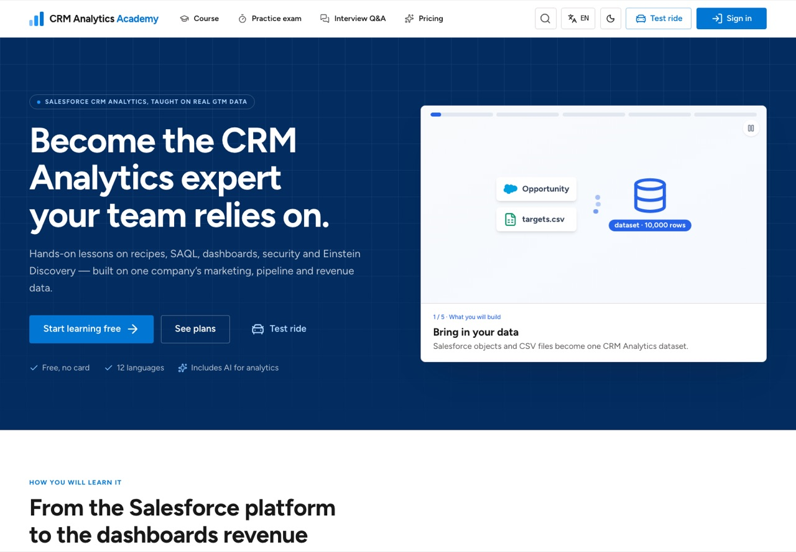
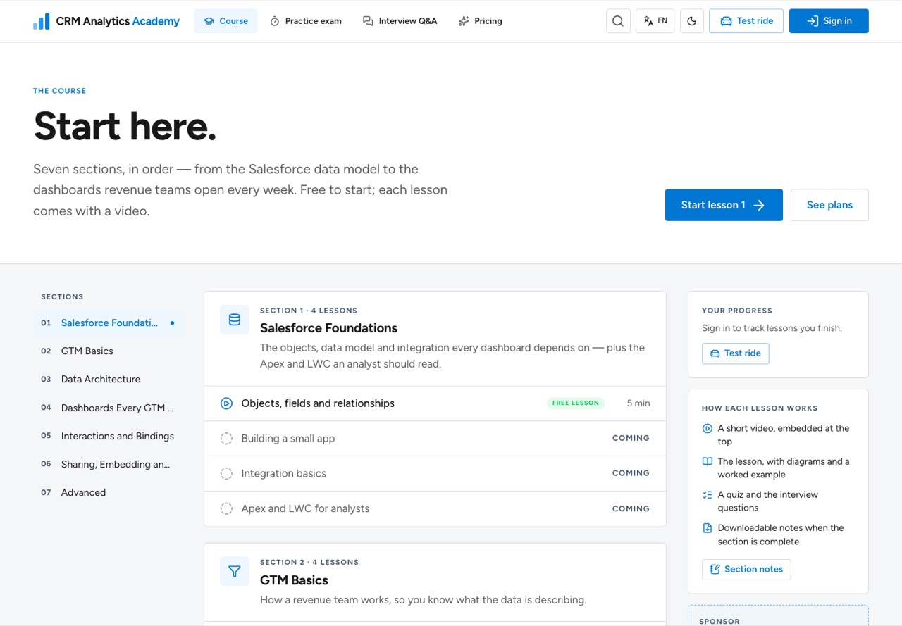
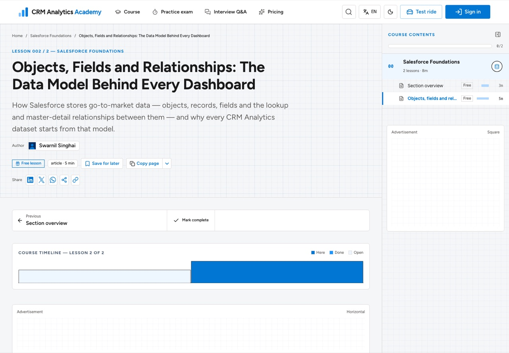
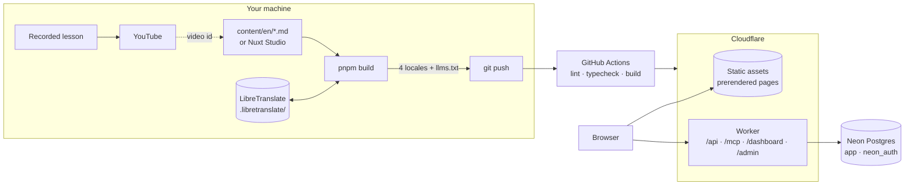

<p align="center"></p>

<h1 align="center">CRM Analytics Academy</h1>

<p align="center">
  <strong>Learn Salesforce CRM Analytics the way go-to-market teams actually use it.</strong><br>
  Data prep, SAQL, dashboards, bindings, Einstein Discovery, and funnel, pipeline and RevOps dashboards
  built end to end, in five languages (English, Spanish, Portuguese, Japanese, German). Most lessons are free and open source; a few hands-on ones are Pro.
</p>

<p align="center">
  <a href="https://crmanalytics.imswarnil.com"><strong>Live site</strong></a> ·
  <a href="https://crmanalytics.imswarnil.com/start"><strong>Start learning</strong></a> ·
  <a href="https://crmanalytics.imswarnil.com/introduction"><strong>Start lesson 1</strong></a> ·
  <a href="https://crmanalytics.imswarnil.com/llms.txt"><strong>llms.txt</strong></a> ·
  <a href="https://crmanalytics.imswarnil.com/contribute"><strong>Contribute</strong></a>
</p>

<p align="center">
  <a href="https://github.com/imswarnil/CRM-Analytics-Academy/stargazers"></a>
  <a href="https://github.com/imswarnil/CRM-Analytics-Academy/actions/workflows/deploy-cloudflare.yml"></a>
  <a href="https://www.youtube.com/@crmanalyticsacademy"></a>
  
  
  
  
  <a href="./LICENSE"></a>
</p>


---

## Why this exists

Salesforce CRM Analytics (formerly Wave, Einstein Analytics and Tableau CRM) is documented well in pieces
and poorly as a path. Most of what is written about it stops at "here is a chart". Very little shows how a
**go-to-market team** uses it: the funnel a marketing lead opens on Monday, the pipeline view a sales
manager reads before the forecast call, the NRR waterfall RevOps takes to the board.

The Academy is that path, in **7 sections**: the Salesforce platform and its data model, GTM basics, data
architecture across many sources, the dashboards revenue teams use every week (KPI, snapshot, change,
conversion, adoption), then bindings, sharing, embedding and Einstein Discovery. The first lessons are
**free**; Pro (monthly, or one lifetime payment) opens everything, and companies and colleges buy seats.
A free account adds progress, streaks, saved lessons, quiz scores and a leaderboard.

> **Published lesson by lesson.** Every lesson has a video on
> [YouTube @crmanalyticsacademy](https://www.youtube.com/@crmanalyticsacademy), embedded on its page, and each
> finished section gets a downloadable notes sheet. [/start](https://crmanalytics.imswarnil.com/start) shows the
> whole plan and what is live.

| You are… | Start here |
| --- | --- |
| New to CRM Analytics | [Introduction](https://crmanalytics.imswarnil.com/introduction) → [Basics](https://crmanalytics.imswarnil.com/foundations) |
| A Salesforce admin or developer adding analytics | [Data Preparation](https://crmanalytics.imswarnil.com/data-preparation) → [SAQL](https://crmanalytics.imswarnil.com/saql) → [Bindings](https://crmanalytics.imswarnil.com/bindings) |
| In RevOps, Sales Ops or Marketing Ops | [GTM Engineering](https://crmanalytics.imswarnil.com/gtm-engineering) → [Demand](https://crmanalytics.imswarnil.com/demand-analytics) → [Pipeline](https://crmanalytics.imswarnil.com/pipeline-analytics) → [RevOps & Retention](https://crmanalytics.imswarnil.com/revops-analytics) |
| An AI assistant | [`/llms.txt`](https://crmanalytics.imswarnil.com/llms.txt) (the course in order) · [`/llms-full.txt`](https://crmanalytics.imswarnil.com/llms-full.txt) (every lesson) · MCP at `/mcp` |
| Preparing for an interview | Every section ends with interview questions and a graded quiz |

## A look inside

| | |
| --- | --- |
|  |  |
| **Home.** What you will build and how the course is taught. | **The course.** Every section in order, what is live and what is coming. |

<p align="center"><br><sub><strong>A lesson.</strong> The video, an animated opener, the lesson, the quiz, and the course beside it.</sub></p>

## Features

**Learning**
- **7 sections in 5 languages** — the whole plan is public on /start and in `llms.txt`; lessons appear as they are recorded.
- **Lesson player** — course-contents sidebar (collapsible to a progress-donut rail), prev / mark complete / next,
  a course timeline, table of contents, screen walkthroughs, graded quizzes, interview Q&A, comments.
- **Lesson videos** published on YouTube and embedded in each lesson.
- **Datasets** (the Academy's own fictional business as CSVs) and curated **resources** with community
  submissions.

**Your dashboard** (free account)
- Continue card and an "up next" queue, progress by section.
- Daily **streak** and longest streak, a **weekly goal** you set, a 26-week **activity heatmap**.
- **Saved lessons**, **quiz scores** with retake prompts, **12 badges**, a top-5 **leaderboard**.

**Pro and products** (no payment processor)
- Lessons marked `access: pro` are members-only: the build ships a teaser, the Worker serves the rest to Pro
  members, and the build fails if any members-only passage is public (`scripts/verify-gating.mjs`).
- `/pro` sells Pro, a certification bootcamp, interview prep, mentoring, dashboard reviews, team training and
  consulting. "Get it" files a lead — saved in Neon and sent to **Salesforce as a Lead by Web-to-Lead** (no
  credentials, no API user). Access is granted by hand in `/admin`.
- Coming-soon sections have a **Notify me** waitlist (free account), with the count of who is waiting.

**Admin console** (`/admin`, one account only)
- **Overview** — visitors, views, users, sign-ups, Pro members, leads, waitlists, completions, submissions.
- **Leads** — every product request, its Salesforce status, and a new → contacted → won/lost pipeline.
- **Conversion** — a per-visitor funnel (visit → engaged → sign-up click → sign-up → learning) and sign-up
  rate by source and landing page.
- **Analytics** — first-party traffic: visitors, sessions, time on page, bounce, countries, devices, browsers,
  OS, referrers, languages, top pages, **sign-in / sign-up clicks** by page, live feed.
- **Users**, **Submissions** (approve / reject) and **Comments** (hide / restore).
- Content is edited in **Nuxt Studio** (`/_studio`), which commits markdown to GitHub.

**Advertising** (Google AdSense — Pro members see none)
- Every placement is a `<PromoSlot>` in a labelled frame, its space reserved
  so nothing jumps, and a fresh unit is requested on every page view.
- In-article units inside lessons, a sticky skyscraper under the table of contents, a unit in the course
  sidebar, a multiplex block after each lesson, a leaderboard on content pages, and a closable floating
  leaderboard. Inventory and slot ids: `app/utils/promo.ts`. `public/ads.txt` is published.
- A timed "subscribe on YouTube" card once per first session (AdSense units are never placed in pop-ups;
  Vignette ads come from AdSense Auto ads).

**Security**
- The site's own **proof-of-work captcha** (no third party) on sign-in, sign-up and lead forms, a honeypot, and
  per-address rate limits stored as hashes.
- Security headers on every response (HSTS, nosniff, frame and base-uri limits), a CSRF origin check on the API,
  escaped JSON-LD, sanitised community content, and an admin pinned to one account.

**Platform**
- **AI-ready** — `llms.txt` lists the course in learning order, `llms-full.txt` holds every lesson, any lesson is
  raw markdown at `/raw/<path>.md`, and a read-only **MCP server** at `/mcp`.
- **Privacy-friendly analytics** — no cookies, no IP addresses, no third-party trackers.
- **SEO** — JSON-LD per page type, hreflang across 5 languages, sitemap, OG images, IndexNow after deploys.
- **PWA** — installable, with an offline page.

## How it works



**Static-first.** Every public page is prerendered and served by Cloudflare straight from the edge. The Worker
runs only for what has no static file: the API, auth, MCP and the signed-in pages. Reading a lesson never
touches the database.

**Translation runs locally.** English is the only language anyone writes. `pnpm build` starts a LibreTranslate
server installed inside the repo (`.libretranslate/`), translates only what changed (a hash manifest tracks the
English source of every file), stops it, and the result is committed. CI never translates.

| Layer | Technology |
| --- | --- |
| Framework | [Nuxt 4](https://nuxt.com) (Vue 3, Vite, Nitro), TypeScript |
| Content | [Nuxt Content 3](https://content.nuxt.com) (markdown + MDC components), edited in [Nuxt Studio](https://nuxt.studio) |
| UI | [Nuxt UI v4](https://ui.nuxt.com), [Tailwind CSS 4](https://tailwindcss.com), the **Namaste Salesforce** design system, Figtree |
| Hosting | [Cloudflare Workers](https://workers.cloudflare.com) (static assets + one Worker), R2 for submission images |
| Database | [Neon](https://neon.com) serverless Postgres — `server/db/schema.sql` |
| Auth | Neon Auth ([Better Auth](https://better-auth.com)), resolved server-side per request; a shared demo account |
| Analytics | Cloudflare Web Analytics + Search Console; milestones in `app.event`; first-touch source into Salesforce |
| Translation | [LibreTranslate](https://libretranslate.com), installed locally, run by `pnpm build` |
| Video | Published on YouTube, embedded per lesson |
| i18n | `@nuxtjs/i18n` — 5 locales (en, es, pt, de, ja) |
| SEO | `@nuxtjs/sitemap`, `nuxt-og-image`, JSON-LD, hreflang, IndexNow |
| Quality | ESLint, `vue-tsc`, GitHub Actions |

## The curriculum

| # | Section | Lessons |
|---|---|---|
| 00 | [Introduction](https://crmanalytics.imswarnil.com/introduction) | 8 |
| 01 | [CRM Analytics Basics](https://crmanalytics.imswarnil.com/foundations) | 9 |
| 02 | [Setup, Profiles & Security](https://crmanalytics.imswarnil.com/setup) | 9 |
| 03 | [Data Preparation](https://crmanalytics.imswarnil.com/data-preparation) | 11 |
| 04 | [Datasets & Modelling](https://crmanalytics.imswarnil.com/datasets-and-modelling) | 8 |
| 05 | [Data Visualization](https://crmanalytics.imswarnil.com/data-visualization) | 13 |
| 06 | [Lenses & Exploration](https://crmanalytics.imswarnil.com/lenses-and-explorations) | 6 |
| 07 | [SAQL](https://crmanalytics.imswarnil.com/saql) | 9 |
| 08 | [Dashboard Design & UI](https://crmanalytics.imswarnil.com/designing-dashboards) | 8 |
| 09 | [Interactions & Faceting](https://crmanalytics.imswarnil.com/interactions) | 6 |
| 10 | [Bindings](https://crmanalytics.imswarnil.com/bindings) | 7 |
| 11 | [Dashboard JSON](https://crmanalytics.imswarnil.com/dashboard-json) | 7 |
| 12 | [Collaboration & Embedding](https://crmanalytics.imswarnil.com/collaboration) | 9 |
| 13 | [APIs & Automation](https://crmanalytics.imswarnil.com/apis-and-automation) | 8 |
| 14 | [Einstein Discovery](https://crmanalytics.imswarnil.com/einstein-discovery) | 8 |
| 15 | [GTM Engineering](https://crmanalytics.imswarnil.com/gtm-engineering) | 9 |
| 16 | [Demand Analytics](https://crmanalytics.imswarnil.com/demand-analytics) | 9 |
| 17 | [Pipeline Analytics](https://crmanalytics.imswarnil.com/pipeline-analytics) | 10 |
| 18 | [RevOps & Retention](https://crmanalytics.imswarnil.com/revops-analytics) | 7 |


## Data model

One idempotent file, [`server/db/schema.sql`](server/db/schema.sql). Users live in Neon Auth's own
`neon_auth."user"`; everything the site owns is in schema `app`, keyed by the user id.

| Table | What it holds |
| --- | --- |
| `app.progress` | Lessons completed (locale-stripped path, so progress follows you across languages) |
| `app.quiz_attempt` | Every quiz attempt; the best score per lesson counts |
| `app.bookmark` | Lessons saved for later |
| `app.comment` | Lesson comments, one level of replies, hide/restore by the admin |
| `app.submission` | Community resources and lesson ideas, with review status |
| `app.demo_account` | The shared demo account |
| `app.page_view` | One row per page view: path, locale, country, device, browser, OS, referrer, time on page |
| `app.event` | Named clicks and milestones: sign-in / sign-up clicks, sign-ups, completions, quizzes, saves |
| `app.user_points` (view) | Points and lessons per user for the dashboard and leaderboard |

## API

| Route | Who | Does |
| --- | --- | --- |
| `GET /api/progress` | learner | Everything the dashboard needs: completions, bookmarks, quizzes, streak, points, rank, leaderboard |
| `POST /api/progress` · `/api/quiz` · `/api/bookmarks` | learner | Mark complete, save a quiz score, save a lesson |
| `GET/POST /api/comments`, `DELETE /api/comments/:id` | anyone / learner | Lesson discussion |
| `GET/POST /api/submissions`, `POST /api/upload` | learner | Submit a resource, dashboard or idea (images to R2) |
| `POST /api/collect` | anyone | First-party analytics beacon (bots dropped, no IP stored) |
| `GET /api/geo`, `/api/url-meta`, `POST /api/newsletter` | anyone | First-visit language, link previews, newsletter |
| `/api/auth/**`, `POST /api/auth/demo` | anyone | Neon Auth proxy, demo sign-in |
| `/api/admin/*` | admin | `me`, `stats`, `analytics`, `users`, `submissions`, `comments` |
| `GET/POST /mcp` | anyone | MCP server: `list_curriculum`, `search_lessons`, `get_lesson` |

The admin is one fixed address (`ADMIN_EMAIL` in `server/utils/admin.ts`); every admin route returns 404 to
anyone else.

## Design: Namaste Salesforce

The site runs on the Namaste Salesforce design system: Salesforce blue `#0176D3` as the only signal colour,
deep navy for title bands and dark mode, white cards on a light grey page, hairline borders, near-flat
elevation, 4px controls and 6px cards, Figtree type and short uppercase labels. `app/assets/css/main.css` is
the source of truth; `brand/` holds the logo mark, icons and YouTube art.

## Directory map

```text
app/                  pages, components (bp/ = shared primitives), composables, plugins
content/              lessons in 5 locales, resources/, people/
server/api/           the routes above · server/db/schema.sql · server/routes/ (mcp, media)
scripts/              prebuild, translate + libretranslate.sh, lesson-meta, search/llms index, indexnow
brand/                logo mark, icons and YouTube channel art (node brand/build.mjs)
salesforce/           SFDX project for the CRM Analytics dev org the course is built in
public/               icons, PWA, sample data, ads.txt, robots.txt (search, raw and llms files are generated)
```

## Scripts

| Command | What it does |
| --- | --- |
| `pnpm dev` | Dev server at http://localhost:3000 |
| `pnpm build` | Translate (local) → lesson meta → search index, llms.txt, /raw → `nuxt build` |
| `pnpm preview` | Build, then run the Worker locally with `wrangler dev` |
| `pnpm translate` | Translate what changed (`--locales=es,fr`, `--only=ui\|content`, `--force`, `--dry-run`) |
| `pnpm translate:setup` | Install LibreTranslate and its models into `.libretranslate/` (once, ~1–2 GB) |
| `pnpm thumb <style> …` | Render a YouTube thumbnail from the Pixelmator templates |
| `pnpm lint` / `pnpm typecheck` | The CI gates |

## Local setup

Node 22+, **pnpm**, and for translation Python 3.11 via [`uv`](https://docs.astral.sh/uv/).

```bash
git clone https://github.com/imswarnil/CRM-Analytics-Academy.git
cd CRM-Analytics-Academy
pnpm install
cp .env.example .env              # only NUXT_PUBLIC_SITE_URL is needed to read lessons
pnpm dev                          # http://localhost:3000
pnpm translate:setup              # once, if you will translate
psql "$DATABASE_URL" -f server/db/schema.sql   # once, for accounts and analytics
```

Without the Neon values the curriculum still renders; only the signed-in features are off. If the docs sidebar
is ever empty in dev, the Nuxt Content dev database is stale: `rm -rf .data && pnpm dev`.

## Publishing

1. Edit English in `content/en/` (or in Nuxt Studio, then `git pull`).
2. `pnpm build` — translates the change into 4 languages and checks the build.
3. Commit everything (English, translations, `.translation-manifest.json`) and push to `main`.
   `.github/workflows/deploy-cloudflare.yml` lints, typechecks, builds and deploys to Cloudflare, then pings
   IndexNow. Runtime secrets live on the Worker (`wrangler secret put …`; names in `.env.example`).

## Why I made this

I have spent seven years building CRM Analytics dashboards for sales, marketing and RevOps teams. Most of
what made those dashboards work — the data model under them, the metric definitions people argued about,
the reasons a dashboard got opened every Monday or never at all — is not in any official course. This is the
course I wish I'd had: built on one company's real go-to-market data, recorded lesson by lesson, and open
for anyone to learn from. — Swarnil

## Contributing

⭐ **The simplest way to help is to [star the repo](https://github.com/imswarnil/CRM-Analytics-Academy).**

Every lesson is a markdown file — fix a typo with **Edit this page** on any lesson, or add a lesson under
`content/en/` (never a Vue file). New UI strings go in `i18n/locales/en.json` only. Run `pnpm lint` and
`pnpm typecheck` before opening a pull request. The full guide is at
[crmanalytics.imswarnil.com/contribute](https://crmanalytics.imswarnil.com/contribute).

CRM Analytics Academy is an independent project and is not affiliated with Salesforce, Inc.

## License

[MIT](./LICENSE).
