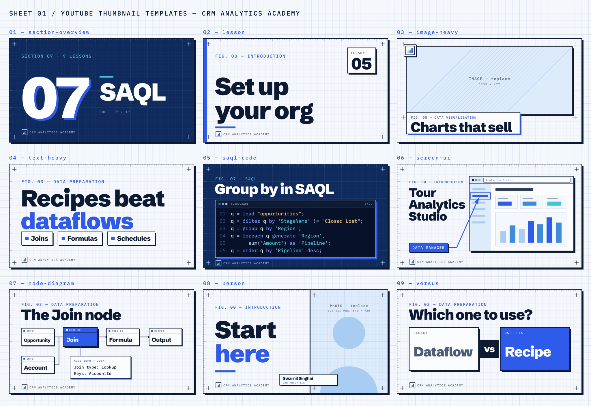

# YouTube thumbnails

Thumbnail templates for the [CRM Analytics Academy channel](https://www.youtube.com/@crmanalyticsacademy),
in the site's Blueprint language (graph paper, crop marks, rulers, ink borders, hard shadows,
square corners, one signal-blue accent). Each style exists three ways:

- `templates/<style>.svg`: layered, hand-editable SVG. Every element is a named `<g id>` and all text is real `<text>`.
- `templates/<style>.pxd`: the same file as a Pixelmator Pro document, with live text layers.
- `previews/<style>.png`: the rendered preview. `previews/contact-sheet.png` shows all of them.



| Style | Use it for |
| --- | --- |
| `section-overview` | The first video of a section. Huge section number, title, `SECTION 07 · 9 LESSONS`, navy ground. |
| `lesson` | A standard lesson. Title, `FIG. 00 — SECTION` eyebrow, lesson-number badge, signal accent bar. |
| `image-heavy` | When a picture sells it. Large framed `IMAGE — replace` slot and a short title strip. |
| `text-heavy` | Concept videos. Two-line headline (second line in signal) and three keyword chips. |
| `saql-code` | SAQL lessons. A dark editor panel with syntax-coloured code under the title. |
| `screen-ui` | Click-through videos. A browser window with a `SCREENSHOT — replace` slot, a callout arrow and a label. |
| `node-diagram` | Recipes and dataflows. A node chain with one highlighted node and a node-info card. |
| `person` | Talking-head videos. `PHOTO — replace` cut-out slot on the right, a 2–4 word hook on the left. |
| `versus` | Comparisons. Two cards (A vs B) under a question. |

## Generating thumbnails

Run these from the repo root. Paths you pass (`--image`, `--code`, `--out`) are relative to the root.

```bash
pnpm thumb lesson introduction/set-up-your-org           # title, section and number come from the lesson file
pnpm thumb lesson --title "Bindings in 5 minutes" --section 10 --lesson 3
pnpm thumb section-overview saql                          # a section from its folder
pnpm thumb --all-sections                                 # one section-overview per folder in content/en
pnpm thumb saql-code --title "Windowing in SAQL" --section 7 --code my-query.saql
pnpm thumb screen-ui --title "Tour Analytics Studio" --image shot.png --callout "Data Manager" --target 580,220
pnpm thumb node-diagram --title "The Join node" --nodes "Opportunity,Join,Formula,Output" --input2 Account \
  --highlight Join --info "Join type: Lookup|Keys: AccountId"
pnpm thumb person --title "Start here" --image public/people/swarnil-singhai.jpg
pnpm thumb versus --title "Which one to use?" --left Dataflow --right Recipe
pnpm thumb lesson introduction/faq --pxd                  # also save a .pxd through Pixelmator Pro
pnpm thumb --list                                         # every style and option
```

Output goes to `content-creation/thumbnails/out/` (gitignored): an SVG and a 1280×720 PNG, plus a
JPEG if the PNG goes over 2 MB, and a `.pxd` when you pass `--pxd`. Coming-soon sections work the same way,
because anything the lesson file would provide can be passed as a flag instead.

When the lesson title runs over six words, the generator uses the shorter `navigation.title`.
Anything longer gets a warning; pass `--title`. Headlines wrap and shrink to fit by themselves.
The widths come from `lib/metrics.json`, Schibsted Grotesk's advance widths at weights 800 and 900.
`python3 lib/metrics.py` regenerates it (it needs fontTools).

`pnpm thumb --templates --pxd` rebuilds `templates/` and `previews/` from the styles in `make.mjs`.
`make.mjs` is the single source: change a style there, not in the SVG.

## Editing in Pixelmator Pro

1. **Install the fonts first:** [Schibsted Grotesk](https://fonts.google.com/specimen/Schibsted+Grotesk)
   (Black 900 and ExtraBold 800) and [IBM Plex Mono](https://fonts.google.com/specimen/IBM+Plex+Mono)
   (Regular and Medium). Without them the text layers fall back to Helvetica.
2. Open `templates/<style>.pxd`, or any SVG from `out/`. Opening an SVG in Pixelmator Pro
   imports it as layers in the same way.
3. Each group layer has an upper-case name: `TITLE`, `EYEBROW`, `BADGE`, `BULLET 1`, `CODE`,
   `CALLOUT`, `NODE 2 — highlight`, `NODE INFO`, `NAME TAG`, `BRAND`, `MARKS`, `BACKGROUND`.
   A multi-line title arrives as one text layer per line inside `TITLE`.
4. **Replacing an image:** select the `IMAGE — replace`, `SCREENSHOT — replace` or `PHOTO — replace`
   group, drop your picture in, and delete the placeholder shapes. For `person`, a cut-out works best:
   select the photo and choose Layer → Remove Background.
5. Export with File → Export → PNG or JPEG, at 1280×720.

## YouTube best practice

- **1280×720** (16:9), JPG/PNG, **under 2 MB**, so `make.mjs` writes a JPEG beside any PNG that goes over.
- **Keep the bottom-right corner clear.** YouTube puts the duration timestamp there (about 200×80 px).
  Every style keeps its text out of that corner.
- Six words or fewer in the headline. Most viewers see the thumbnail at about 168×94 px, so check
  the PNG zoomed out before you upload.
- Keep one accent per thumbnail. Signal blue does that job; it is never mixed with a second loud colour.
